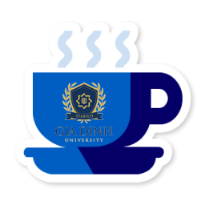

# ☕ Coffee24h — GDU Edition (Keep-Awake & System Power Daemon)

<p align="center">
  
  &nbsp;&nbsp;&nbsp;&nbsp;
  
</p>

<p align="center">
  <strong>High-Performance Keep-Awake Utility & Background Compute Persistence Daemon</strong><br />
  <em>Engineered for Gia Dinh University (GDU) — Conceived as a Core Component for a Future University OS</em>
</p>

<p align="center">
  <a href="https://github.com/nynwadhyhcz8/Coffee24h"></a>
  <a href="https://golang.org"></a>
  <a href="https://wails.io"></a>
  <a href="https://github.com/nynwadhyhcz8/Coffee24h/blob/main/LICENSE"></a>
</p>

---

## 🎓 About Gia Dinh University (GDU)

**Trường Đại học Gia Định (Gia Dinh University - GDU)** is a progressive, forward-thinking university in Ho Chi Minh City, Vietnam. Rooted in the core philosophy of *"Ứng dụng - Trải nghiệm - Việc làm"* (Hands-on Application - Practical Experience - Employment Readiness) with the campus motto **"Chọn Gia Định - Chọn Thành Công"**, GDU places strong emphasis on real-world engineering, student innovation, and software craftsmanship.

### 🎨 Authentic GDU Visual Identity & Dual Editions
Coffee24h was crafted specifically around GDU's brand identity:
- **Colors:** Deep Oceanic Navy (`#061120`, `#0b2545`), Radiant Gold (`#f59e0b`), Flame Red (`#dc2626`).
- **👔 GDU Giảng Viên (Lecturer Edition):** Classical blue ceramic mug adorned with the official GDU emblem.
- **🌱 GDU Sinh Viên (Student Edition):** Eco-friendly leaf cup representing student dynamism, green campus sustainability, and fresh ideas.
- *Switchable dynamically on-the-fly with 1 click or CLI flags (`--student` / `--lecturer`).*

---

## 🌌 The Mission: Paving the Way for a University Operating System (GDU OS)

> *"Coffee24h was envisioned and coded by **Neith Do** on an ambitious mission: to research and contribute foundational, rock-solid system daemons toward the vision of a dedicated **University Operating System (GDU OS)** for Gia Dinh University."*

In modern university environments, research labs, and computer science departments, workstations are subjected to heavy, long-running computational workloads:
- **Machine Learning & Deep Neural Network Training** running over several hours.
- **Large Codebase Compilation, Kernel Building & 3D CAD Rendering**.
- **Automated Research Daemons & Lab Data Pipelines**.

When conventional operating systems arbitrarily enter standby or sleep mode, training checkpoints break, network sockets terminate, and critical student research is disrupted.

Coffee24h serves as a **production-grade proof-of-concept and subsystem module** for the future GDU OS, delivering:
1. **Low-level sleep interception** via direct kernel execution state registers (`SetThreadExecutionState` on Windows, `caffeinate` on macOS, `systemd-inhibit` on Linux).
2. **Pinned OS thread execution** (`runtime.LockOSThread()`) to prevent Go runtime goroutine migration from dropping OS wake flags.
3. **Smart hardware battery telemetry** to safeguard student laptops (<5% threshold auto-release).
4. **Shell auto-recovery** (`RegisterWindowMessageW("TaskbarCreated")`) ensuring tray persistence even if the desktop environment restarts.

---

## 🚀 Key Features

1. **Until Off Mode (Vô Hạn)**:
   - Blocks OS sleep, screen dimming, and screensaver.
   - Laptop stays active continuously until you stop it or the battery discharges completely.
2. **System-Only Awake Mode (Chạy Nền)**:
   - Allows screen to turn off to conserve battery and protect OLED/IPS displays, while keeping the CPU, background tasks, downloads, and rendering alive.
3. **Timed Mode (Hẹn Giờ)**:
   - Quick presets for **15m**, **30m**, **1h**, **2h**, and **4h** with active countdown timer and harmonic bell chimes.
4. **Smart Battery Safeguard (Bảo Vệ Pin)**:
   - Automatically releases awake mode if battery falls below 5% to prevent sudden data corruption and give the OS a chance to hibernate gracefully.
5. **Real-time Battery Telemetry**:
   - Detects AC status, battery percentage, and charging state dynamically.
6. **One-Click Workstation Lock (Win + L)**:
   - Instant security lock when stepping away from the desk in university libraries or labs.
7. **4-Corner Subpixel Antialiased Rounded Window**:
   - DirectComposition 32-bit ARGB with smooth 14px rounded corners and zero 1-bit GDI jagged pixel artifacts.

---

## 🖥️ Cross-Platform Architecture

| OS | Keep-Awake Mechanism | Battery Detection | Workstation Lock |
| :--- | :--- | :--- | :--- |
| **Windows** | Native Win32 `SetThreadExecutionState` (`ES_CONTINUOUS \| ES_SYSTEM_REQUIRED \| ES_DISPLAY_REQUIRED`) | Win32 `GetSystemPowerStatus` | `user32.dll` `LockWorkStation` |
| **macOS** | Subprocess `caffeinate -i -d` | macOS `pmset -g batt` | `pmset displaysleepnow` |
| **Linux** | D-Bus / `systemd-inhibit` (fallback: `xdg-screensaver`) | Linux `/sys/class/power_supply/` | `loginctl lock-session` |

---

## 🛠️ Building & Running

> [!IMPORTANT]
> This application is built with **Wails v2**. If you compile with plain `go build` without tags, Wails will request build tags. Always build using either the **Wails CLI** or `go build -tags desktop,production`.

### Prerequisites
- **Go** (1.20+): `winget install GoLang.Go`
- **Node.js** (npm LTS): `winget install OpenJS.NodeJS.LTS`
- **Wails CLI**: `go install github.com/wailsapp/wails/v2/cmd/wails@latest`
- **WebView2 Runtime**: Preinstalled on Windows 10/11

---

### Option 1: Standard Wails Build (Recommended)
From this directory (`coffeeGDU`):
```powershell
# Compiles frontend with Vite and packages the executable into build/bin/
wails build
```

### Option 2: Manual Go Build
```powershell
# 1. Build frontend
cd frontend
npm install
npm run build
cd ..

# 2. Embed Windows icon & resources (if go-winres installed)
go-winres make --arch amd64

# 3. Build Go binary with Wails production tags
go build -tags desktop,production -ldflags "-H windowsgui -w -s" -o coffee24h.exe .
```

---

## ⚙️ Various Ways to Set Up Coffee24h

Double-click **`setup.cmd`** in the root directory (or run `setup.ps1` via PowerShell) to open the interactive setup manager:

```text
==============================================================
   Coffee24h - Multi-Setup Manager (Various Setup Options)
   Keep-Awake Utility for Gia Dinh University (GDU)
==============================================================
  [1] Full Setup (All Recommended Setups in 1-Click)
  [2] Terminal CLI Setup (Add to PATH & WinGet Links)
  [3] Auto-Start on Windows Login (Silent to System Tray)
  [4] Create Desktop Shortcut (Custom GDU Icon)
  [5] Create Start Menu Shortcut (Windows Searchable)
  [6] Win + R Run Dialog ('coffee24h')
  [7] PowerShell Profile Aliases ('coffee', 'c24')
  [8] Remove / Uninstall All Integrations
==============================================================
```

---

## 💻 Command-Line Interface (CLI)

```text
Usage:
  coffee24h [flags]

Flags:
  -h, --help            Show CLI help reference
  -v, --version         Show application version
  -m, --tray            Start directly into System Tray ("Show hidden icons")
  -a, --awake           Immediately activate Keep-Awake mode upon launch
  -t, --time <dur>      Start a timed session (e.g. 15m, 30m, 1h, 2h, 4h, 90m)
  -s, --system-only     Keep CPU/downloads awake with display sleep enabled
  -l, --autolock        Auto-lock workstation (Win + L) when session expires
  --student             Launch in GDU Student Edition (Eco-friendly Leaf Cup)
  --lecturer            Launch in GDU Lecturer Edition (Blue GDU Logo Cup)
  --no-safeguard        Disable battery safeguard (<5% auto-stop)

Examples:
  coffee24h                    # Launch GUI normally
  coffee24h --tray             # Start silently in "Show hidden icons"
  coffee24h --awake            # Launch and immediately keep laptop awake
  coffee24h --time 2h          # Keep awake for 2 hours with timer
  coffee24h -s --time 1h       # 1 hour system-only awake (screen turns off, CPU runs)
  coffee24h --student          # Launch directly with GDU Student Edition
```

---

## 📦 Cross-Platform Packaging

### 🍎 macOS (.app / .dmg)
```bash
wails build -platform darwin/universal
./build/darwin/build-dmg.sh
```
Output: `build/bin/Coffee24h.app` & `build/bin/Coffee24h-macOS-Universal.dmg`

### 🐧 Linux (.deb / AppImage)
```bash
wails build -platform linux/amd64
./build/linux/build-deb.sh 1.0.0
./build/linux/build-appimage.sh
```
Output: `build/bin/coffee24h_1.0.0_amd64.deb` & `build/bin/Coffee24h-x86_64.AppImage`

### 🪟 Windows (.exe / NSIS Installer)
```powershell
wails build
wails build -nsis
```
Output: `build/bin/coffee24h.exe` & `build/bin/coffee24h-installer.exe`

---

## 👨‍💻 Author & Mission Dedication

- **Author & Lead Developer:** **Neith Do** ([@nynwadhyhcz8](https://github.com/nynwadhyhcz8) / `16av112thien@gmail.com`)
- **Dedication:** Proudly designed and coded for **Gia Dinh University (GDU)**.
- **Mission:** A research stepping stone toward a future academic **University Operating System (GDU OS)**.
- **Architecture Documentation:** See [`DEVELOPER_GUIDE.md`](../DEVELOPER_GUIDE.md) for full deep-dive architectural notes.
